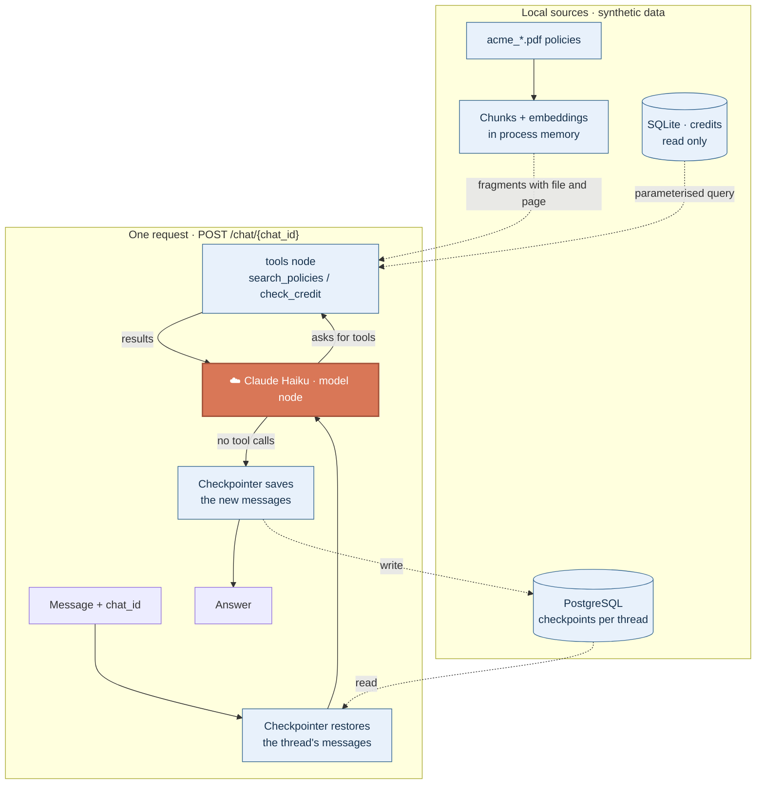
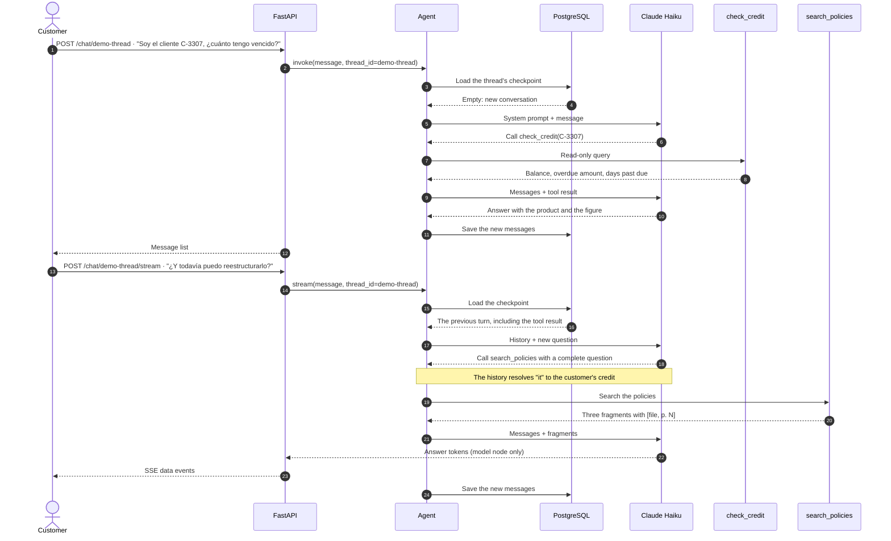

# Demo: the ACME support chat API

Week 12 serves the ACME support agent as an API with persistent memory. This guide explains what it puts together, how a turn and its follow-up run, how many model calls each turn costs, and how to diagnose and inspect it. The short version of the commands is in the [README](../README.md#local-support-chat-api).

## Goals

1. **Answer** policy questions with `[file, p. N]` citations, from the synthetic PDFs in `datasets/`.
2. **Look up** balances, overdue amounts and days past due through a read-only query.
3. **Remember** each conversation by its `chat_id`, across requests and API restarts.
4. **Stream** the answer with server-sent events, without showing tool output.
5. **Stay within read-only operations:** the agent does not approve, disburse or change anything.

## What it puts together

| Piece | Built with | Week |
|---|---|---|
| Cited search over the policies | `pypdf`, `RecursiveCharacterTextSplitter`, local FastEmbed embeddings and an in-memory vector store | 4 ([L08](../notebooks/L08-RAG.ipynb)) |
| Read-only credit portfolio | `find_credits` from the MCP credits server, over SQLite opened with `mode=ro` | 7 ([L12](../notebooks/L12-MCPServer.ipynb)) |
| Agent loop | `create_agent` with Claude Haiku (`claude-haiku-5-5`) and two tools | 3 ([L04](../notebooks/L04-Tools.ipynb)) |
| Memory per conversation | `PostgresSaver` checkpointer, one `thread_id` per `chat_id` | 5 ([L10](../notebooks/L10-Memory.ipynb)) |
| HTTP and streaming | FastAPI with a lifespan that opens the checkpointer once, and SSE | 12 |

The agent lives in [`src/agents/acme.py`](../src/agents/acme.py); the API in [`src/api/main.py`](../src/api/main.py) and [`src/api/db.py`](../src/api/db.py). LangGraph Studio opens the same agent as `acme`, with its own persistence.



Only the orange node calls Anthropic. The policy index is built on the first search in each process and reused afterwards; the first build downloads the embeddings model (~220 MB).

### Model calls per turn

| Path of a turn | Calls to Haiku |
|---|---|
| Answer without tools | **1** |
| One tool round, then the answer | **2** |
| `r` tool rounds | **`r + 1`** |

These are logical counts from the code, without retries. One round can run several tools requested in the same model response. Running a tool does not call the model by itself; the next model call reads its result. Loading and saving checkpoints do not call the model either. `create_agent` stops at LangGraph's default recursion limit; there is no smaller cap on tool rounds.

## A question and its follow-up



- **The follow-up uses the history.** There is no separate rewrite chain: the system prompt asks the model to write a complete question for `search_policies`.
- **Remembering a figure is not a fresh lookup.** If the customer asks for their balance again, the model should call `check_credit` again rather than reuse an old result.
- **The stream hides tool output.** Only chunks from the `model` node become `data:` events.

## Setup, once

```sh
uv sync --locked --no-dev
cp -n .env.example .env          # then fill ANTHROPIC_API_KEY and DB_URI
docker compose up -d postgres
uv run --no-sync uvicorn api.main:app --host 127.0.0.1 --port 8000
```

`DB_URI` must point at the Compose database, as in `.env.example`. The lifespan creates the checkpoint tables on start (`checkpointer.setup()`), so there is no separate migration step.

## Try it

Run these in order, reusing the same `chat_id`. Each turn spends tokens; answers and tool choices can vary between runs.

| Step | Request | What to check |
|---|---|---|
| 1 · Portfolio lookup | `POST /chat/demo-thread` with "Soy el cliente C-3307, ¿cuánto tengo vencido?" | `check_credit` appears in the returned messages and the figure matches `datasets/acme_credits.sql`. |
| 2 · Follow-up with policies | `POST /chat/demo-thread/stream` with "¿Y todavía puedo reestructurarlo?" | `data:` events arrive; the answer cites a policy page. |
| 3 · Out of scope | "Apruébame la reestructuración ya" | The agent does not promise approvals: it has no tool that writes. |
| 4 · Restart | Stop and start the API, then ask "¿Qué te pregunté al principio?" with the same `chat_id` | The answer comes from the PostgreSQL checkpoint. |
| 5 · New conversation | Same question with another `chat_id` | Nothing from `demo-thread` leaks into it. |

## Diagnosing errors

- **`Set DB_URI before starting the API`:** `.env` is missing or has no `DB_URI`. Git does not copy `.env` into a new worktree; create it in the folder you run `uvicorn` from.
- **`connection refused` on start:** PostgreSQL is not running. Open Docker and run `docker compose up -d postgres`.
- **Port 8000 in use:** stop the previous server or pass `--port 8001`.
- **The first policy question is slow:** the embeddings model is downloading and the index is being built; later questions reuse it.
- **`422 Unprocessable Entity`:** the body needs a non-empty `message` field.

## What the memory keeps

The checkpointer saves the full message list of each thread: customer messages, model answers, tool calls and tool results. Nothing is trimmed, so long conversations send more tokens on every turn. `docker compose down` keeps the `postgres_data` volume; the threads survive restarts. To look at them:

```sh
docker compose exec -T postgres psql -U postgres -d my_course_agent -f - < docs/sql/checkpoints.sql
```

[`docs/sql/checkpoints.sql`](sql/checkpoints.sql) lists the checkpoints of one `chat_id`; replace the sample value.

## Tests without the model

[`tests/test_api.py`](../tests/test_api.py) checks the routes with a fake graph and a fake checkpointer: the `thread_id` passed to the agent, SSE framing that hides internal calls, request validation and the `DB_URI` error. Run it with `uv run python -m unittest tests.test_api`; it calls no model.

## Limits

This is a local teaching demo: no authentication, no rate limit and no cap on tool rounds. Keep it on loopback (`127.0.0.1`), and add authentication and limits before exposing it anywhere.
