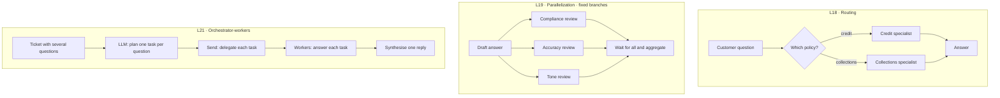
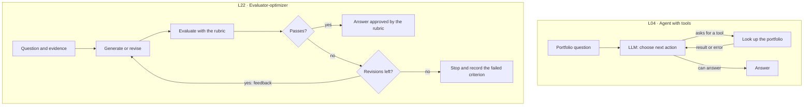

# Agentic patterns and dynamic prompts

This course treats the LangGraph and Anthropic patterns as an explicit framework for designing, comparing and evaluating LLM workflows. The goal is that you can **explain why you chose a structure, implement it and measure what it changes** in quality, cost and latency.

## Two core references

1. **[LangGraph: Workflows and agents](https://docs.langchain.com/oss/python/langgraph/workflows-agents)** is the implementation reference. Read the section for each pattern and follow the state, the decisions and the stop conditions in its code.
2. **[Anthropic: Building effective agents](https://www.anthropic.com/engineering/building-effective-agents)** is the conceptual reference from the team that builds Claude. Read its architectural distinctions and when-to-use criteria next to the LangGraph examples.

Both guide this selection; they are not an exhaustive list of possible architectures. The mapping to weeks and the ACME examples are the course's adaptation. Book chapters and code for each week are in [readings.md](readings.md).

## Workflow or agent?

A **workflow** fixes the execution structure in code; it may still contain model decisions. An **agent** lets the model choose its next actions and tools from the results it observes. A loop or a variable output does not, by itself, make something an agent. The LLM augmented with retrieval, tools or memory is the building block of both ([Anthropic](https://www.anthropic.com/engineering/building-effective-agents)).

## Pattern catalog and where the course covers it

**The first five are workflows; the last one is the agent loop.**

| Pattern | Structure and when to use it | In the course |
| --- | --- | --- |
| **[Prompt chaining](https://docs.langchain.com/oss/python/langgraph/workflows-agents#prompt-chaining)** | Sequential steps: one call feeds the next, with checks (gates) in between. For tasks you can split up front. | [L17](../notebooks/L17-Chaining.ipynb) classifies an ACME ticket, stops at a gate if it is not about credit, then extracts and answers. The rewrite → retrieve → answer chain of [L09](../notebooks/L09-ConversationalRAG.ipynb) is the same pattern. |
| **[Routing](https://docs.langchain.com/oss/python/langgraph/workflows-agents#routing)** | Pick one specialised path from the input. For categories that need different treatment. | [L18](../notebooks/L18-Routing.ipynb): a router with structured output sends each question to the credit, disbursement, payments or collections specialist. |
| **[Parallelization](https://docs.langchain.com/oss/python/langgraph/workflows-agents#parallelization)** | Run independent subtasks and aggregate. Anthropic distinguishes **sectioning** (split the work) and **voting** (several attempts at the same task). | [L19](../notebooks/L19-Parallelization.ipynb): sectioning, with three fixed reviewers (compliance, accuracy, tone) joined by a reducer. Voting is optional reading. |
| **[Orchestrator-workers](https://docs.langchain.com/oss/python/langgraph/workflows-agents#orchestrator-worker)** | The model breaks the request down, delegates subtasks and the results are joined. For work whose breakdown depends on the input. | [L21](../notebooks/L21-Orchestrator.ipynb): a structured plan, one worker per task with `Send`, a worker subgraph and a synthesiser. |
| **[Evaluator-optimizer](https://docs.langchain.com/oss/python/langgraph/workflows-agents#evaluator-optimizer)** | Generate, evaluate and revise with feedback. For outputs that explicit criteria can improve. | [L22](../notebooks/L22-EvaluatorOptimizer.ipynb): a rubric, a revision cap and the feedback loop. |
| **[Agents](https://docs.langchain.com/oss/python/langgraph/workflows-agents#agents)** | The model chooses actions, receives tool results and continues or stops. For paths that need decisions during execution. | [L04](../notebooks/L04-Tools.ipynb) with `create_agent`, MCP tools in [L13](../notebooks/L13-MCPAgent.ipynb) and the ACME assistant of week 12. |

Human approval ([L20](../notebooks/L20-HumanInTheLoop.ipynb)) is not a pattern of its own: it is a pause you add to any of them before an action that writes or moves money.

## What they look like in the course

### Weeks 8 and 10: choose, check in parallel or delegate a plan

In L21, check **what the planner decided**, not just how many workers ran. A `for` loop that splits a fixed list shows dynamic distribution of work, but it does not show that the model planned. Make the plan, its validation and the mapping from task to result visible.

### Weeks 3 and 11: decide an action or revise an answer

In the agent, execution limits and error handling live in code. In the evaluator-optimizer, reaching the revision cap does not make an answer approved: keep the rubric result. A LangSmith/OpenEvals experiment over a dataset ([L11](../notebooks/L11-RAGEvaluation.ipynb)) then compares both versions; that measurement is different from the evaluation that drives the loop.

## Specialists, subagents and supporting capabilities

Use these terms to describe an exercise precisely:

| Term | What your design must make explicit | Where |
| --- | --- | --- |
| **Specialist** | Its responsibility, inputs and tools. It can be a node, a subgraph or an agent with its own loop. | L18 and L21 |
| **Subagent** | What work it receives from the caller and what it decides by itself. Keep the term for components that behave as agents. | L21 when the exercise needs it; not every worker is an agent. |
| **Multi-agent system** | Which agents take part, how they coordinate and how they share results. Name the coordination pattern too. | Architecture discussion in week 10 |
| **Subgraph** | The input/output contract and the state it encapsulates. It may hold deterministic steps or model decisions. | L21 |
| **Jinja and dynamic prompts** | How instructions are built from variables and rules. | [L03](../notebooks/L03-DynamicPrompting.ipynb) |
| **RAG and memory** | Which sources are retrieved, how history is kept and how conversations are isolated. | L06–L10 |
| **MCP and tools** | Which capabilities are exposed, how they are selected and what code validates. | L04, L05, L12, L13 |
| **Human-in-the-loop** | Which action needs approval and how execution is saved and resumed. | L20 |

So a useful description reads "a router picks a policy specialist" or "an orchestrator delegates tasks to workers with explicit contracts". Calling it only "multi-agent" does not say which structure was built.

## Dynamic prompts

Keep Jinja templates versioned in the repository and separate template, context and user message. Pass user values as data to the renderer, use `StrictUndefined` so a missing variable fails, and review template changes together with the code ([L03](../notebooks/L03-DynamicPrompting.ipynb), [Jinja templates](https://jinja.palletsprojects.com/en/stable/templates/)).

## Before each week

- **Week 8:** the prompt chaining, routing and parallelization sections of both references.
- **Week 10:** orchestrator-workers.
- **Week 11:** evaluator-optimizer.
- The agents section goes with week 3 and comes back when you compare architectures.

The code in each LangGraph section is the technical reference for the pattern; adapt it to the course setup in [SETUP.md](../SETUP.md). Models and install commands in external guides are their authors' examples; they do not change the course environment.

## What to show when you choose a pattern

For each exercise and for the final project, record:

- **Problem and simple alternative:** what fails with the first solution and which decision justifies the pattern.
- **Structure:** which steps the code fixes, what the model decides and what data the components exchange.
- **Verifiable behaviour:** the route taken, the branches completed, the tasks delegated or the revisions made.
- **Impact:** quality, cost and latency against the simple alternative on the same examples. A parallel run can cut waiting time and still raise total cost.
- **Termination:** the success criterion, the cap on tasks or revisions and what is returned when the rubric is not met.

Reuse the patterns that help the problem; the final project does not need to combine them all.
